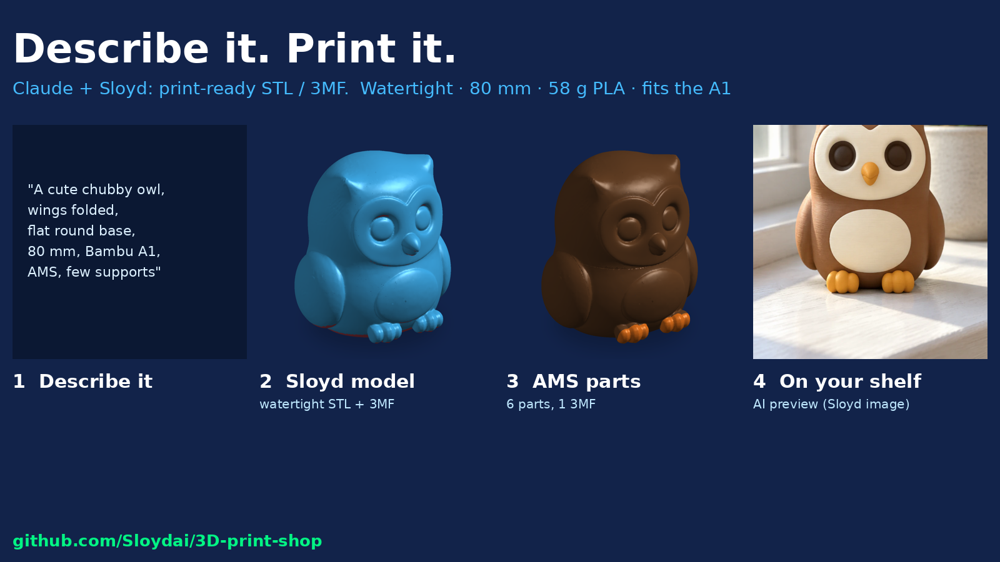

# 3D Print Shop

**Describe it. Print it.** A print shop for your coding agent. Describe what you want, or attach a photo or sketch, and get a print-ready STL and 3MF for your Bambu Lab, Prusa or Elegoo printer: watertight, in real millimetres, on a flat base, with a wall-thickness and overhang report and the slicer settings.

Built for makers. Powered by the [Sloyd API](https://www.sloyd.ai/api).



*A real run: "a cute chubby owl, 80 mm, Bambu A1, AMS" became a watertight 80.0 mm STL (58 g PLA) and a 6-part AMS 3MF in about 6 minutes, for 90 credits (~$1.20). [See the example](examples/desk-owl/).*

```
/plugin marketplace add Sloydai/3D-print-shop
/plugin install 3d-print-shop@sloyd-3d-print-shop
```

## The team

```
3d-print-shop/
├── print-shop-manager     runs the job from one prompt, quotes credits once, quality gate, hands over the files
├── print-designer         asks purpose, size in mm, FDM vs resin, printer, colours, supports; writes a printable prompt
├── modeler                text, photo/sketch or multi-view to GLB with Sloyd
├── print-prep             local script: GLB to watertight STL + 3MF in mm, flat base or name plinth, print report
├── multi-color-splitter   Sloyd split into parts, per-part STLs and one AMS/MMU 3MF with filament slots
├── gift-maker             pet figurine from a photo, name plaques, toys from a kid's drawing
├── reel-maker             Shorts/Reels plan: photoreal stills of the print in a real place, turntable, shot list
└── sloyd-api              shared plumbing: credentials, credits, job polling, errors, REST fallback
```

Each role hands its output to the next through one job folder:

1. print-designer writes `brief.json` (prompt, size, printer, tech, colours)
2. modeler generates `sloyd/model.glb` and records the job
3. print-prep writes `print_ready/` (STL, 3MF, `report.md`, preview)
4. multi-color-splitter adds `parts/` and a multi-part 3MF
5. reel-maker adds `reel/` (stills, turntable, `shotlist.md`)

## What you get

```
print-jobs/desk-owl/
├── brief.json            the request, printable prompt, size, printer, every Sloyd job and its credits
├── sloyd/                model.glb, concept.png, parts.glb
├── print_ready/          desk-owl.stl, desk-owl.3mf, report.md, preview.png
│   └── parts/            one STL per filament (multi-colour)
└── reel/                 still_A.png, still_B.png, turntable.mp4, shotlist.md
```

`report.md` covers: size in mm, watertight check, filament grams, build-plate fit, thinnest wall, overhangs and support islands, bed contact and tip-over risk, and one fix per warning (e.g. "tree supports, threshold 45").

## Setup

1. **Get your own Sloyd API key.** Each user brings their own credentials, and generations are billed to your prepaid credits.
   1. Go to [api-dashboard.sloyd.ai](https://api-dashboard.sloyd.ai), open **API Keys** and click **Generate Key**. Copy the secret; it's shown once.
   2. Buy credits under **Usage & Billing**. The minimum is $12 for 900 credits.
2. **Export the key** in the shell you start your agent from, or copy `.env.example` to a git-ignored `.env`.

   ```bash
   export SLOYD_CLIENT_ID="sok_live_..."
   export SLOYD_CLIENT_SECRET="..."
   ```

3. **Install the plugin** (above). It registers Sloyd's hosted MCP server (`https://api.sloyd.ai/api/mcp`) using those two variables. To add the server by hand instead:

   ```bash
   claude mcp add --transport http sloyd https://api.sloyd.ai/api/mcp \
     --header "x-client-id: $SLOYD_CLIENT_ID" \
     --header "x-client-secret: $SLOYD_CLIENT_SECRET"
   ```

4. **Install the print-prep dependencies** (Python 3.10+):

   ```bash
   python3 -m pip install -r skills/print-prep/scripts/requirements.txt
   ```

Other agents (Cursor, VS Code, Codex and others) can load the `skills/` folders directly. Clients without MCP use the bundled standard-library client, `skills/sloyd-api/scripts/sloyd.py --via rest`. Credentials are only read from the environment and never written to any file.

## Example prompts

- `Make me a printable 80 mm owl for my Bambu A1. One colour, I hate supports.`
- `Here's a photo of my dog Biscuit. Make a figurine with her name on the base for my mum's birthday, AMS 4 colours.` (attach a photo)
- `Turn my daughter's drawing into a toy she can hold. Prusa MK4S, PETG.` (attach the drawing)
- `A 32 mm dwarf blacksmith miniature for my Elegoo Saturn 4 Ultra.`
- `This dragon is too big for my A1 mini. Split it into pieces with pins.`
- `My slicer says this STL is non-manifold. Fix it and scale it to 120 mm.`
- `Make a vertical reel of my print that starts and ends on my windowsill.`

## Cost

Sloyd API credits ($1 = 75 credits). The agent always shows the estimate and your balance before spending.

| Step | Credits |
|---|---|
| Text to 3D, untextured (single filament) / textured | 15 / 25 |
| Image to 3D, untextured / textured | 10 / 20 |
| Split into parts | 40 |
| Concept image / image edit (gifts, reel stills) | 10 / 15 |
| Print prep, renders, turntable | free (runs locally) |

The example run came in exactly at its 90-credit quote: model 25, split 40, two reel stills 25. Current prices: [sloyd.ai/api/pricing](https://www.sloyd.ai/api/pricing).

## Example: desk owl

[`examples/desk-owl/`](examples/desk-owl/) is the real output of one run:

- the brief and printable prompt, with every step's credits
- print-prep reports for the single-colour and AMS versions
- 3D viewer screenshots of the Sloyd model and the print-ready parts
- Sloyd's concept image, the photoreal reel stills, the turntable and the shot list
- what the run found, and what changed in the skills because of it
- the 3D models are not included: run the prompt with your own Sloyd key to make them

## Tests

```bash
python3 -m pip install -r skills/print-prep/scripts/requirements.txt pytest
python3 -m pytest tests -q
```

The tests build a deliberately broken GLB that imitates generator output (glTF metres, Y-up, overlapping shells, a hole, a round bottom, a floating speck, a sticking-out wing, per-part colours) and check that print-prep turns it into a watertight STL at exactly the requested size, with a flat base, a strict-valid 3MF in mm, per-part STLs that reassemble exactly, AMS slots, a raised name label, and the thin-wall, too-big and resin checks.

## Requirements

- Python 3.10+ with the packages in `skills/print-prep/scripts/requirements.txt` (trimesh, manifold3d and friends). `sloyd.py` needs only the standard library.
- A Sloyd API key with credits
- A slicer: Bambu Studio, OrcaSlicer, PrusaSlicer, or Chitubox/Lychee for resin

## Limits

- AI meshes are organic shapes and aren't dimensionally exact. Use CAD for functional parts with tolerances.
- Generators can't spell, so all lettering is made locally (`print_prep.py --label`).
- Sloyd's public API has no video generation yet. reel-maker makes the stills, turntable and prompts, and marks the animation step pending. It never uses another provider.

## Privacy

Prompts and images you send are processed by Sloyd. See the [Sloyd privacy policy](https://www.sloyd.ai/privacy-policy).

## License

MIT
