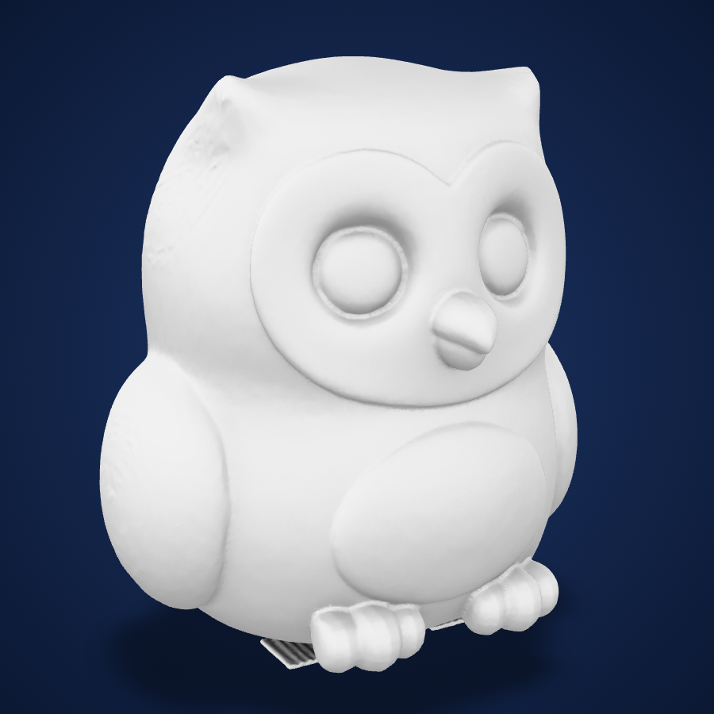
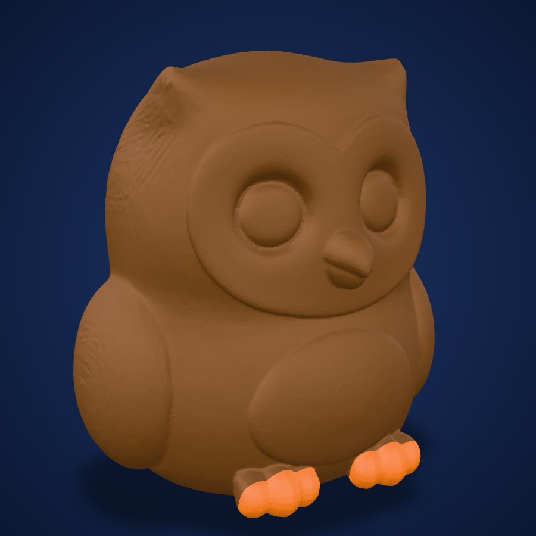
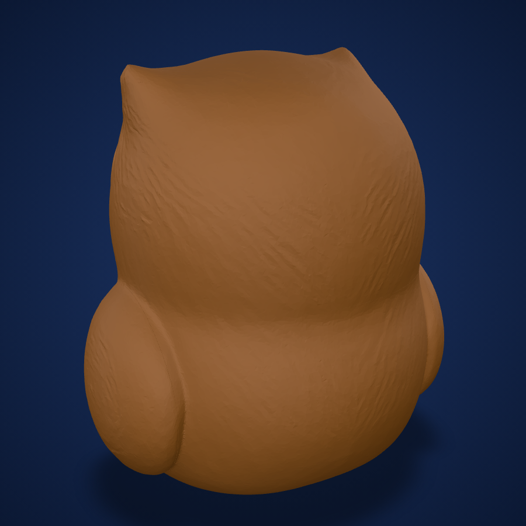

# Example: Desk Owl (real end-to-end run, 2026-11-04)

The whole team, run once on the real Sloyd API. Nothing here is a mockup. The photoreal stills are AI images from Sloyd and are labelled as such.

**The 3D models are not included** (no GLB, STL or 3MF, and the model job IDs are withheld). This folder has the brief, the reports, screenshots and the reel stills. Run the same prompt with your own Sloyd key to make the files.

**Request:** "A cute owl for my desk, 80 mm, Bambu A1 with AMS lite, 4 colours, as few supports as possible."

| Step | Role | Sloyd job | Credits | Result |
|---|---|---|---|---|
| Brief + printable prompt | print-designer | none | 0 | `brief.json` |
| Text-to-3D, textured, `Color3DPrint` | modeler | `(model job ID not published)` (110 s) | 25 | GLB, 100k faces, 3 shells (not included) |
| Print prep | print-prep | local | 0 | STL + 3MF, see `print_ready/report.md` |
| Split, partition, 6 parts | multi-color-splitter | `(split job ID not published)` (220 s) | 40 | 6 parts, see `print_ready_ams/report.md` |
| Reference upload | reel-maker | `3oxbl9yo` | 0 | Sloyd's concept image |
| Photoreal still A | reel-maker | `ejzns5mc` | 10 | `reel/still_A.png` |
| Photoreal still B | reel-maker | `qlijf8ar` | 15 | `reel/still_B.png` |
| Turntable | reel-maker | local | 0 | `reel/turntable.mp4` |
| **Total** | | | **90** | balance 505 to 415 |

## Screenshots

Taken in a browser 3D viewer (Google `<model-viewer>`, page in `screenshots/viewer.html`) from the actual files of this run.

| Sloyd model as delivered | Print-ready, AMS colours (front) | Print-ready, AMS colours (back) |
|---|---|---|
|  |  |  |
| The raw Sloyd GLB. Its texture is grayscale only. Note the loose fragment under the feet | The print-ready AMS file: the 6 watertight parts with their assigned filaments (brown, orange feet). The fragment is gone and the base is cut flat | Back of the same file: smooth wings and body, no thin parts |

To view your own model the same way, serve `screenshots/viewer.html` next to your GLB and open `viewer.html?m=<file.glb>`.

## Print-ready result (`print_ready/report.md`)

- **73.3 x 64.5 x 80.0 mm**, watertight, 1 body, 95k faces
- about **58 g PLA**, fits the Bambu A1
- Thinnest wall ~8.5 mm, so nothing is at risk
- 3 shells unioned, 2 floating specks removed, base cut flat (1.1 mm), 529 mm² of bed contact
- Overhangs on 10.9% of the surface (under the wings and chin). Print with **tree supports**.

## AMS version (`print_ready_ams/`)

Sloyd's `partition` split returned **6 parts: Head, Body, 2 Wings, 2 Feet**, each watertight. All 6 sit as components of one 3MF in their assembled positions.

### What this run found (fixed in the team)

1. **The textured GLB had no colour.** Its only texture was a grayscale ambient-occlusion map (`AO_Preview`), even though the job had `Color3DPrint` and `textureResolution: auto`. print-prep now flags this (`no_texture_colour`), and `--colors "Foot_*=orange,*=brown"` sets filaments by part name. The colours were taken from Sloyd's concept image (`sloyd/concept.png`).
2. **The split follows anatomy, not paint.** The cream face and belly aren't separate parts. The AMS file is brown + orange feet (2 slots). Add the cream regions with Bambu Studio's colour-paint tool on the Head and Body parts.
3. Sloyd returned the stills as WebP. `sloyd.py` now converts them to the format you asked for.

## Run it yourself

```
Make me a printable 80 mm owl for my Bambu A1 with AMS: cute and chubby, wings folded, flat base, as few supports as possible.
```

The exact generation prompt print-designer wrote is in `brief.json`. Expect about 90 credits for the full run (model, split, two reel stills), or 25 for the model alone.
